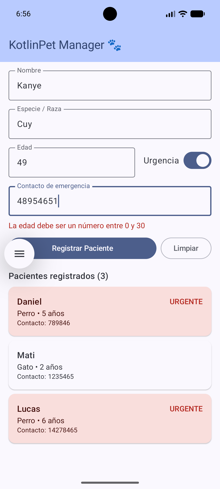

# KotlinPet Manager 🐾

**Estudiante:** Daniel Santiago Cabrera Vela\
**Código:** 1085914015 \
**Asignatura:** Desarrollo de Aplicativos Móviles (EE053)\
**Universidad:** Universidad Tecnológica de Pereira

## Descripción

KotlinPet Manager es una aplicación móvil de una sola pantalla para la gestión básica de una clínica veterinaria.
Esta app nos permite registrar pacientes mediante un formulario, el cual al rellenarse, deja ver los clientes ingresados en una lista dinámica, resaltando los casos de urgencia.

## Funcionalidades

- Registro de pacientes con nombre, especie o raza, edad y contacto de emergencia.
- Indicador de urgencia para marcar los casos que requieren atención inmediata.
- Validación de datos con mensajes de error, sin cierres inesperados.
- Lista de pacientes en tiempo real con tarjetas de Material 3.
- Botón para limpiar el formulario.

## Captura de pantalla

